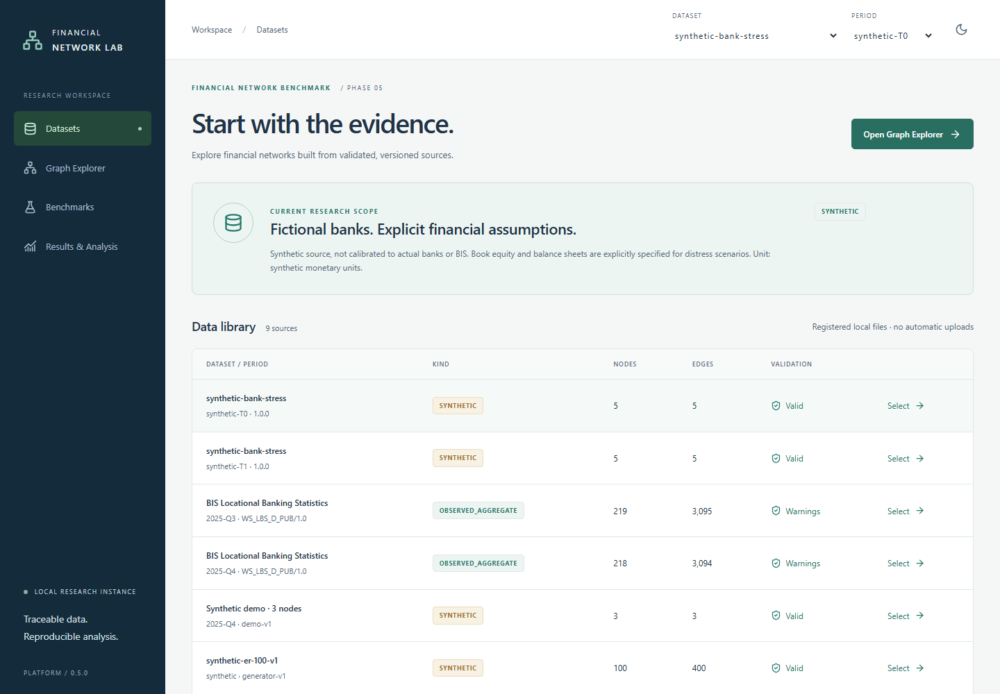
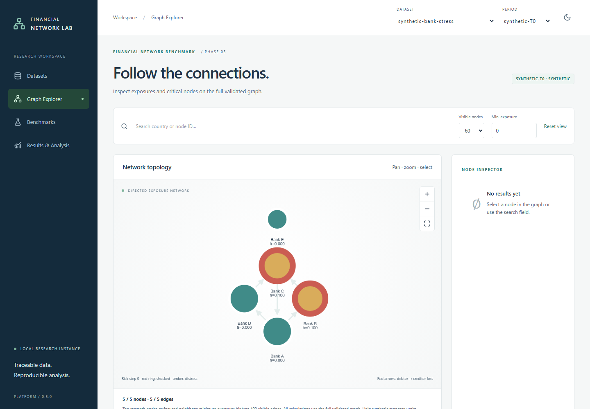
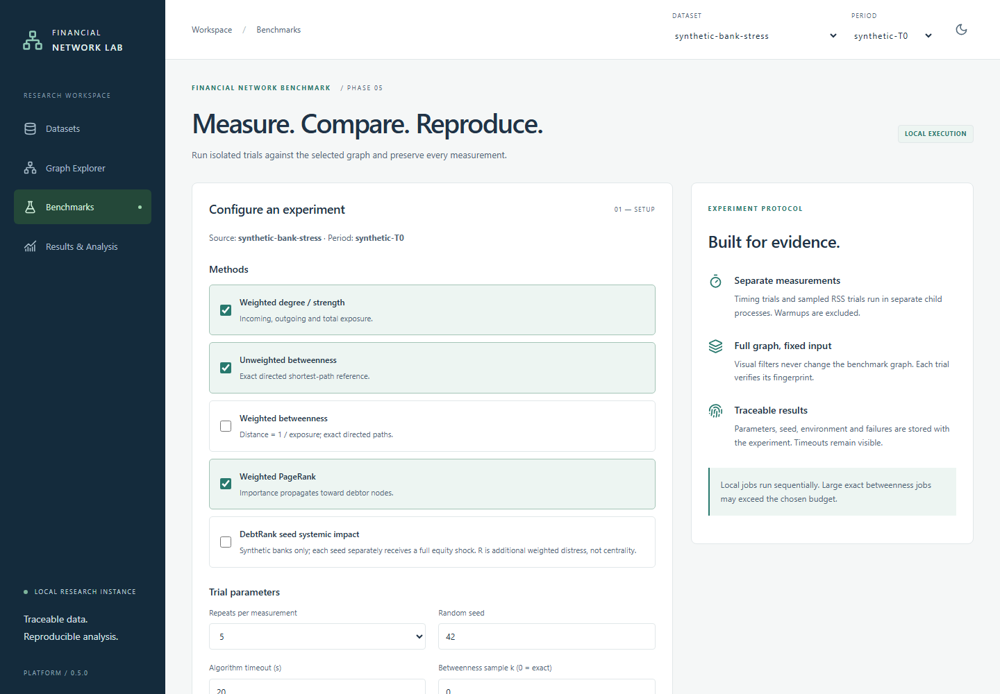
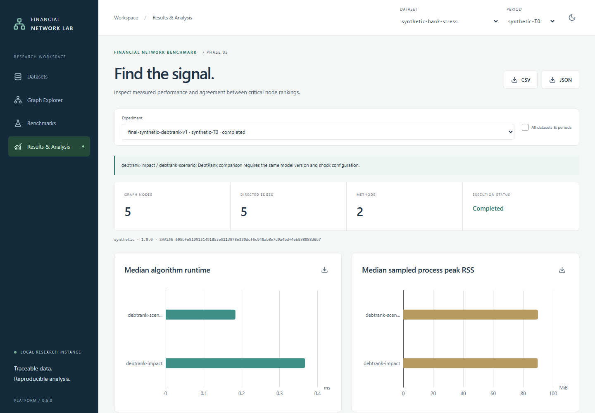
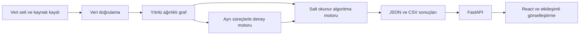

# Financial Network Benchmark

**Finansal Ağlarda Graf Tabanlı Darboğaz Tespiti ve Algoritma Performans Analizi**

## Projenin Amacı

BIS LBS dosyalarını doğrulayan, yönlü/ağırlıklı finansal ilişki grafı oluşturan ve
kritik düğüm yöntemlerini tekrarlanabilir deneylerle inceleyen yerel araştırma platformu.
Faz 0–6 kapsamı uygulanmıştır; final doğrulama ve açık kabul maddeleri
[teslim raporunda](docs/final-delivery-report.md) kayıtlıdır.

**Gerçek veri kapsamı:** A ülkesindeki raporlayan bankalar → B ülkesindeki tüm borçlu
sektörler. Düğümler ülke/bölgedir; bireysel banka ağı değildir. Kredi/mevduat alacak
stokları milyon USD cinsindedir. Ayrı `synthetic-bank-stress` kaynağı, yalnızca hayali
bankalarda DebtRank çalıştırır. Gerçek BIS verisine sermaye veya risk skoru eklenmez.

## Araştırma Soruları

Maruziyet büyüklüğü, yapısal aracılık ve yönlü önem farklı kritik düğüm tanımlarıdır.
Araştırma bunların sıralama uyumunu ve hesaplama maliyetini inceler. Sentetik distress
etkisi ayrı model/hedef olarak tutulur. Etiketli kriz/temerrüt verisi bulunmadığından
sıralama uyumu tahmin doğruluğu, merkezilik de likidite darboğazı olarak sunulmaz.

## Projenin Özellikleri

- CSV/Parquet, açık kolon eşleme, dönem seçimi ve kaynak/hash provenansı.
- Kayıp değer, birim, tekrar ve yön kontrolleri; sessiz kayıt silme yok.
- Strength, exact/approximate betweenness, açık inverse-exposure dönüşümü, PageRank.
- Bağımsız sentetik bankalarda tek geçişli DebtRank ve çoklu şok/dönem senaryoları.
- Ayrı süreçlerde zaman/RSS denemeleri; ham sonuç, özet, ortam ve kaynak kod arşivi.
- Datasets, Graph Explorer, Benchmarks, Results & Analysis; açık/koyu ve mobil görünüm.
- JSON/CSV sonuç ve SVG grafik export. Max-Flow, finansal kapasite modeli yokken ertelendi.

## Teknolojiler

Python 3.11, NetworkX 3.6.1, pandas, PyArrow, SciPy, psutil, FastAPI; React, strict
TypeScript, Vite, Tailwind CSS, Cytoscape.js ve Apache ECharts. Windows üzerinde
Node 24.22.1 / npm 11.6.2 ile doğrulandı. Python tam sürümleri
`backend/requirements-lock.txt`, JavaScript sürümleri `frontend/package-lock.json` içindedir.

## Sistem Mimarisi

[Mimari](docs/architecture.md) modül/süreç sınırlarını gösterir. Backend `backend/app`,
frontend `frontend/src`, küçük sentetik kaynak `data/demo`, sentetik banka modeli
`backend/app/datasets/synthetic_banks.json` altındadır. `data/raw`, `data/processed`,
`experiments` ve bağımlılıklar Git dışındadır; yerel sonuçlar bu klasörlerde korunur.

## Kurulum Rehberi

PowerShell, proje kökünde:

```powershell
python -m venv .venv
.\.venv\Scripts\python.exe -m pip install -r backend/requirements-lock.txt
.\.venv\Scripts\python.exe -m pip install --no-deps -e backend
cd frontend
npm ci --no-audit --no-fund
npm run build
cd ..
```

Node/npm sistemde bulunmalıdır. CI npm 11.6.2 kullanır; gerekirse
`npm install --global npm@11.6.2` ile aynı araç sürümünü seçin. pnpm kilidi yerine
npm kilidi kullanılır. Kurulum bağımlılık kayıtlarına internet erişimi gerektirir;
testler finansal veri indirmez. Farklı işletim sistemi/araç sürümü ayrıca doğrulanmalıdır.

## Veri Setleri ve Hazırlama

Sentetik kaynaklar indirme gerektirmez ve açıkça etiketlidir. Gerçek çalışma kesitleri
2025-Q3 ve Q4'tür; bunların en güncel dönem olduğu iddia edilmez.

```powershell
.\.venv\Scripts\python.exe scripts/fetch_bis.py --period 2025-Q4 --output data/raw/bis-all-sectors-2025q4
.\.venv\Scripts\fnb.exe validate --input data/demo/observations.csv --manifest data/demo/manifest.json --period 2025-Q4 --output data/processed/my-demo-validation
.\.venv\Scripts\fnb.exe build --input data/demo/observations.csv --manifest data/demo/manifest.json --period 2025-Q4 --output data/processed/my-demo-graph
```

CLI çıktı dizini yeni olmalıdır. Yerel doğrulanmış CSV/Parquet kullanılabilir.
Gerçek BIS için eksik kayıt dışlama gerekiyorsa `--missing-policy exclude` açıkça seçilir;
eksik veya yayımlanmayan çiftler sıfır yapılmaz. Kolonlar tahmin edilmez.
[Dataset sözleşmesi](docs/datasets.md), [doğrulama](docs/data-validation.md),
[graf modeli](docs/graph-model.md). Veri dosyaları değişince API'yi yeniden başlatın.
Tarayıcı dosya yüklemesi kapalıdır.

## Backend Servisini Başlatma

```powershell
.\.venv\Scripts\python.exe -m uvicorn app.api.main:app --host 127.0.0.1 --port 8000
```

Derlenmiş uygulama: **http://127.0.0.1:8000**. OpenAPI: **http://127.0.0.1:8000/docs**.
Tek worker ve yerel bağlantı kullanın; bu sürüm çok kullanıcılı internet servisi değildir.
Job süreçleri asenkrondur, iptal edilebilir; yeniden başlatılan işler sürdürülmez.
[API, önbellek ve job sınırları](docs/web-platform.md).

## Web Arayüzünü Başlatma

API açıkken ikinci terminalde:

```powershell
cd frontend
npm run dev
```

Geliştirme URL'si **http://127.0.0.1:5173**. `npm run build` sonrasında API tek başına
arayüzü sunabilir. Graf en fazla 250 düğüm ve 400 kenar çizer; görünür/toplam sayılar
ayrı gösterilir. Filtreler tüm graf üzerinde çalışan algoritmaları değiştirmez.

## Performans Karşılaştırması

```powershell
.\.venv\Scripts\python.exe -m app.benchmark.cli run --config configs/benchmarks/synthetic-100.json
.\.venv\Scripts\python.exe -m app.benchmark.cli run --config configs/benchmarks/synthetic-debtrank.json
# Orijinal yerel BIS dosyası ve manifesti varsa:
.\.venv\Scripts\python.exe -m app.benchmark.cli run --config configs/benchmarks/bis-2025q4.json
```

Aynı experiment ID/konfigürasyon yeni run üretir; farklı konfigürasyonda yeni ID gerekir.
Sonuçlar `experiments/<experiment_id>/runs/<run_id>` altında saklanır. Beş zaman ve beş
ayrı RSS denemesi varsayılandır; warmup ölçümlerden dışlanır. Timeout başarısızlığı sıfır
süreye çevrilmez. [Ölçüm protokolü](docs/benchmark-methodology.md).

## Deneylerin Yeniden Üretilmesi

```powershell
.\.venv\Scripts\python.exe scripts/run_final_experiments.py
# Gerçek Q4 kesiti mevcutsa; yeni çıktı dosyası seçin:
.\.venv\Scripts\python.exe scripts/run_final_experiments.py --include-bis --output data/processed/my-final-index.json
```

[Tekrarlanabilirlik](docs/reproducibility.md) girdileri, hash doğrulamasını, kaynak kod
arşivini, ortamı ve tarihsel koşuların sınırlamalarını açıklar. İndirilen revize veri
eski hash'i üretmek zorunda değildir; erişim tarihini değiştirerek hash taklit etmeyin.
Nihai sayısal bulgular [deneysel sonuçlar](docs/experimental-results.md), izlenebilir
kayıtlar `docs/evidence-index.json` içindedir. Eski ve yeni ortam ölçümleri birleştirilmez.

## Testler ve Kurulum Doğrulama

```powershell
.\.venv\Scripts\python.exe -m ruff check --config backend/pyproject.toml backend/app scripts tests
.\.venv\Scripts\python.exe -m mypy --config-file mypy.ini
.\.venv\Scripts\python.exe -m pytest -q
cd frontend
npm run lint
npm run typecheck
npm test
npm run build
npx playwright install chromium
cd ..
```

mypy kademeli olarak iki model/IO modülünü denetler; bütün backend'in statik tip
kapsamında olduğu iddia edilmez. Tam sentetik, izole tarayıcı koşusu:

```powershell
.\.venv\Scripts\python.exe scripts/prepare_ci_fixture.py --output data/processed/my-ci-workspace
$env:FNB_PROJECT_ROOT=(Resolve-Path 'data/processed/my-ci-workspace').Path
$env:FNB_E2E_MANAGED='1'
$env:FNB_WEB_URL='http://127.0.0.1:4173'
cd frontend
npm run test:e2e
```

Playwright test API'sini otomatik açar/kapatır. Bu koşu gerçek BIS gerektirmez.
Gerçek veri testi isteğe bağlıdır: normal proje kökündeki 8000 sunucusunda
`FNB_REAL_DATA=1`, `FNB_WEB_URL=http://127.0.0.1:8000` ve managed flag kapalı olmalıdır.
Yeni terminal normal demo ayarlarına döner. Workflow:
[final-validation.yml](.github/workflows/final-validation.yml). GitHub üzerindeki
koşu durumu yalnızca gerçekten tetiklenmişse doğrulanmış sayılır.

## Bilinen Sınırlamalar

Gözlenen BIS grafı kısmi, ülke düzeyinde ve kurumsal kapsamı asimetriktir; gerçek banka
sermayesi veya ödeme kapasitesi yoktur. Merkezilik bir temerrüt/likidite tahmini değildir.
DebtRank sadece ayrı kurgu ağdadır; bilanço tanımı ve tek geçiş varsayımı sonuçları sınırlar.
RSS süreç tabanını içerir; süreler makine yükü, cache ve platformdan etkilenir.
Büyük exact betweenness bütçeyi aşabilir. Gerçek kriz etiketleriyle öngörü testi,
igraph eşdeğerlik/performans deneyi veya üretim deployment yapılmadı.
[Kabul durumu ve bilinen sorunlar](docs/final-delivery-report.md).

## Kullanılan Kaynaklar ve Atıf

[Algoritma tanımları](docs/algorithms.md), [gelişmiş model](docs/advanced-financial-analysis.md),
[akademik rapor taslağı](docs/research-report.md), [demo akışı](docs/demo-guide.md).
Birincil referanslar: [BIS LBS](https://data.bis.org/topics/LBS),
[Brandes 2001](https://www.uni-konstanz.de/algo/publications/b-fabc-01.pdf),
[Brin & Page 1998](https://snap.stanford.edu/class/cs224w-readings/Brin98Anatomy.pdf),
[Battiston et al. 2012](https://doi.org/10.1038/srep00541),
[Bardoscia et al. 2015](https://doi.org/10.1371/journal.pone.0130406).

## Lisans

Proje kodu kullanıcı onayıyla MIT lisanslıdır; tam metin LICENSE dosyasındadır. Üçüncü taraf paketler kendi lisanslarına tabidir.
BIS istatistikleri [BIS kullanım koşullarına](https://data.bis.org/help/legal) tabidir;
kaynak atfı korunur, destek/bağlantı izlenimi verilmez ve Türkçe açıklamalar resmî BIS
çevirisi değildir. Ham finansal veri Git'e eklenmez. Sentetik kaynaklar bağımsız kurgu
olarak etiketlidir. Public paylaşım öncesi kod lisansı ve veri kullanım koşulları gözden geçirilmelidir.


## Araştırma Sorularının Kapsamı

1. Hangi ülke/bölge düğümleri yapısal olarak kritiktir?
2. Farklı yöntemlerin seçtiği düğümler hangi ölçüde örtüşür?
3. Çalışma süresi ve bellek tüketimi nasıl değişir?
4. Graf büyüdüğünde maliyet nasıl ölçeklenir?
5. Dönemler arasında sıralamalar nasıl değişir?
6. Benzerlikler hangi varsayımlarda anlamlıdır?

Gerçek veri ülke düzeyindedir; bireysel kurumların belirlenmesi iddia edilmez. Yazılım
kişisel yatırım veya finansal karar tavsiyesi üretmez.

## Uygulamanın Gerçek Ekran Görüntüleri

Aşağıdaki görseller çalışan uygulamadan alınmıştır. Görsellerdeki banka ağı ve
finansal tutarlar **açıkça sentetiktir**, gerçek banka verisi değildir.

### Veri Setleri

### Graf Keşif Ekranı

### Deney Yapılandırma Ekranı

Bu ekran deneyi yapılandırır; süre ve bellek karşılaştırma grafikleri sonuçlar ekranındadır.
### Sonuçlar ve Analiz


## Veri Akışı



CSV/Parquet okuma ve doğrulama veri modülünde, graf kurma NetworkX katmanında,
yöntemler algoritma motorunda yürütülür. Deney motoru ham ölçümleri ve ortamı dosyalarda
saklar; SQLite kullanılmaz. Tarayıcı gerçek FastAPI sonuçlarını alır; sabit başarı
sonuçlarıyla gerçek hesaplama taklit edilmez.

## Graf Algoritmaları

| Yöntem | Girdi ve çıktı | Yorum |
|---|---|---|
| Ağırlıklı giriş/çıkış derecesi ve güç | Yön ve maruziyet; düğüm başına derece ve tutar toplamı | Maruziyet büyüklüğü |
| Arasındalık merkeziliği | Yönlü graf; birim adım veya açık c/exposure mesafesi; düğüm skoru | Yapısal kısa yol aracılığı; gerçek bulaşma kanıtı değil |
| PageRank | Yönlü ağırlıklı/ağırlıksız graf ve yakınsama ayarları | Borçlu yönünde önem; temerrüt olasılığı değil |
| DebtRank | Yalnızca bağımsız sentetik banka ağı ve özkaynak/şoklar | Alınan distress ile ayrı başlangıç düğümü etkisi ayrılır |

Max-Flow/Min-Cut uygulanmadı; maruziyet stoğu likidite kapasitesi sayılmaz.
Yöntemler aynı matematiksel sorunu çözmez. Süre, ayrı süreç RSS belleği, tekrar,
ortalama/medyan/standart sapma/minimum/maksimum, ölçeklenebilirlik, ilk K örtüşmesi,
Jaccard ve Spearman ölçülür. Sıralama benzerliği tek başına doğruluk kanıtı değildir.

## Kuruluma Başlamadan Önce

Doğrulanan ortam: Windows, Python 3.11.1, Node.js 24.22.1, npm 11.6.2.
Python minimum sürümü 3.11'dir. Git ve Node/npm PATH üzerinde olmalıdır.
Resmî kurulumlar: [Python](https://www.python.org/downloads/),
[Node.js](https://nodejs.org/en/download), [Git](https://git-scm.com/downloads).

```bash
git clone https://github.com/tubadeligoz/financial-network-benchmark.git
cd financial-network-benchmark
```

Public/main yayını kullanıcı tarafından onaylanmıştır; GitHub oturumu açıldıktan sonra yayın ve erişim kontrolü tamamlanacaktır.

### macOS ve Ubuntu

Bu komutlar proje yapısına uyarlanmıştır; **bu oturumda macOS/Linux üzerinde çalıştırılmadı**.
Python 3.11+, Node 24 ve Git'i kurduktan sonra:

```bash
python3 -m venv .venv
source .venv/bin/activate
python -m pip install -r backend/requirements-lock.txt
python -m pip install --no-deps -e backend
cd frontend
npm ci --no-audit --no-fund
npm run build
cd ..
python -m uvicorn app.api.main:app --host 127.0.0.1 --port 8000
```

Windows PowerShell komutları yukarıdaki Kurulum Rehberi bölümündedir. Ortamı
etkinleştirmek isterseniz ` .\.venv\Scripts\Activate.ps1 ` kullanın; yürütme ilkesi
engelliyorsa sistem ilkesini değiştirmek yerine belgelenmiş tam Python yolunu kullanın.
Sistem API anahtarı gerektirmez. `.env` otomatik yüklenmez; gerekirse `FNB_PROJECT_ROOT`
ortam değişkeniyle proje kökü seçilir. Gerçek gizli anahtar içeren örnek dosya yoktur.

### Yaygın Kurulum Hataları

| Sorun | Kontrol |
|---|---|
| Python/Node bulunamıyor | Kurulumdan sonra terminali yeniden açın; PATH ve sürümü doğrulayın |
| Port kullanımda | Aynı projeye ait önceki sunucuyu kapatın; başka süreçleri gelişigüzel sonlandırmayın |
| Backend bağlantısı/CORS | API 8000, geliştirme arayüzü 5173; belgelenmiş yerel adresleri kullanın |
| Veri bulunamadı | İndirme klasörünü ve manifesti kontrol edin; sentetik kaynaklarla başlayabilirsiniz |
| Python bağımlılığı eksik | Aynı sanal ortamın Python'u ile requirements dosyasını kurun |
| Web derleme hatası | Node/npm sürümünü doğrulayın ve frontend içinde npm ci çalıştırın |
| Kaynak değişti hatası | Dosya doğrulamasından sonra API'yi yeniden başlatın |

## Nasıl Kullanılır?

1. API ve arayüzü açın; veri setini ve dönemi seçin.
2. Doğrulama raporunu açın; kaynak kapsamını ve sentetik/gerçek ayrımını inceleyin.
3. Graf keşif ekranında düğüm arayın; düğüm/kenar seçimi, zoom ve filtreleri kullanın.
4. Yöntemi seçip hesaplayın; hesaplanmamış skorları sonuç sanmayın.
5. Deneyler ekranında yöntem, tekrar ve parametreleri belirleyip çalıştırın.
6. Gerçek iş durumu tamamlanınca sonuçları açın; uygun sıralama karşılaştırmalarını inceleyin.
7. JSON/CSV veya grafik SVG'sini indirin. Sentetik finansal stres için ayrı banka kaynağını seçin.

## Proje Klasör Yapısı

```text
financial-network-benchmark/
├── backend/       # Veri, graf, yöntemler, deney motoru ve API
├── frontend/      # React arayüzü ve tarayıcı testleri
├── configs/       # Çalıştırılabilir deney ayarları
├── data/demo/     # Açıkça sentetik küçük veri
├── tests/         # Python doğruluk ve entegrasyon testleri
├── docs/          # Araştırma, kullanım ve gerçek ekran görüntüleri
├── scripts/       # İndirme, ölçüm ve rapor araçları
└── README.md
```

Yerel `data/raw`, `data/processed` ve `experiments` klasörleri çalışırken oluşur;
varsayılan public dosya paketine dahil değildir.

## Deneysel Sonuçlar

Aşağıdakiler final Q4 BIS ülke grafının gerçek ölçümleridir (218 düğüm, 3094 kenar).

| Yöntem | Medyan süre (ms) | Medyan süreç RSS (MiB) |
|---|---:|---:|
| Güç | 3.5964 | 103.309 |
| PageRank | 4.3928 | 112.832 |
| Birim adımlı exact arasındalık | 22.9319 | 104.035 |
| Ters maruziyetli exact arasındalık | 57.9705 | 105.391 |

Her yöntem için 5 zaman ve 5 ayrı bellek denemesi yapıldı. Bunlar tek bilgisayardaki
gözlemlerdir; RSS süreç tabanını içerir. Ayrı sentetik DebtRank sonuçları, kritik düğüm
sıralamaları, benzerlikler ve tarihsel ölçek deneyleri [ayrıntılı raporlardadır](docs/experimental-results.md).
Ortam, donanım, sürümler ve kaynak hash'leri rapor kayıtlarında korunur. Rastgelelik tohumu
örnek ayarlarda 42, tekrar sayısı 5'tir; her koşunun asıl ayarı kendi dosyasında kayıtlıdır.

## Kullanılmayan Veri Adayları

AI4Risk ve HEIDIcell başlangıç adaylarıydı; mevcut uygulamada kullanılmazlar.
Birincil gerçek kaynak BIS LBS'dir. Banka ilişkileri bilanço verisinden yeniden
oluşturulmuş gibi sunulmaz; BIS'in yayımladığı ülke toplamları grafa yansıtılır.

## Projeye Katkıda Bulunma

Türkçe [katkı rehberini](CONTRIBUTING.md) izleyin. Proje kodu MIT lisanslıdır.
`CITATION.cff`, tamamı onaylanan dört ekip üyesini içerir: Tuba Rukiye Dan,
Aysu Nacakcı, Özge Çelik ve Edanur Aysan. Atıf için bu dosyayı kullanın.
Bireysel katkı rolleri ve ORCID bilgileri verilmediğinden eklenmemiştir.
