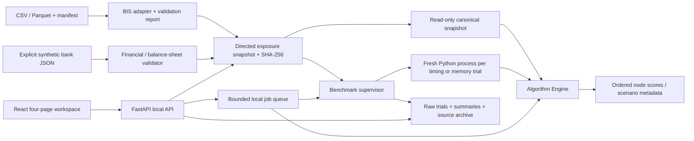

# Architecture

Bu belge Faz 6 doğrulaması sonrası çalışan yerel mimariyi tanımlar. Yeni finansal
algoritma veya dağıtık servis eklenmedi.

## Module boundaries

| Katman | Modüller | Sorumluluk |
|---|---|---|
| Veri | `datasets/io.py`, `bis.py`, `financial.py` | Format, şema, kaynak, dönem, eksik/bozuk girdiler |
| Veri modeli | `core/models.py` | Dataset, Report, kontrollü DataError |
| Graf | `graph/builder.py`, `statistics.py`, `weights.py` | Kimlik/yön/birim, canonical hash, betimsel istatistik, açık mesafe dönüşümü |
| Algoritma | `algorithms/base.py`, `engine.py`, ayrı yöntem modülleri | Spec, parametre ve graf doğrulaması, salt okunur çalıştırma, sonuç şeması |
| Deney | `benchmark/config.py`, `source.py`, `worker.py`, `measurement.py`, `manager.py`, `storage.py` | Süreç sınırı, ölçüm, tekrar, kaynak arşivi, özet ve uygun karşılaştırma |
| API | `api/repository.py`, `schemas.py`, `main.py`, `jobs.py`, `worker.py`, `stress.py` | Kayıtlı kaynaklar, HTTP sözleşmesi, asenkron yerel işler, export |
| Web | `frontend/src/api`, `hooks`, `components`, `pages` | İstek durumu, kaynak/dönem seçimi, graph/chart ve dört ekran |

## Data and mathematical contracts

Graf `creditor → debtor` yönünde, pozitif `exposure` stok tutarı taşır. Distance
ayrı türetilmiş katmandadır. DebtRank zararı ters yönde, `debtor → creditor` aktarır.
Gerçek BIS düğümü ülke/bölgedir; incoming/outgoing kurum kapsamı eşit değildir.
Sentetik bankalar ayrı dataset/kind, özkaynak, birim ve varsayım taşır. Alanları
yetersiz graf finansal risk hesabına otomatik geçirilmez.

Engine canonical ve derin salt okunur kopya verir. Dataset sürümü, kaynak/hash,
dönem ve parametreler sonuçla taşınır. Eşit skor sıralaması node ID ile deterministiktir.
Scenario distress ve ayrı seed impact sıralaması farklı matematiksel hedeflerdir.
Benchmark bu hedefleri merkezilik skorlarıyla otomatik ranking matrisine karıştırmaz.

## Processes, cache and storage

API bir yerel queue thread'i ve en fazla 8 bekleyen/aktif iş kullanır. İş ayrı Python
sürecindedir; benchmark her trial için ayrıca yeni süreç açar. İptal/timeout süreç
ağacını durdurur. Tek API worker gerekir; restart aktif işi sürdürmez.

Repository ilk katalog isteğinde kaynakları doğrular, küçük metadata kataloğunu
saklar ve en fazla 3 graf/statistik çiftini LRU düzeninde tutar. Dosya mtime/size
değişirse kullanım reddedilir ve restart istenir; hesaplamada tam kaynak hash'i
ayrıca kontrol edilir. Küçük tamamlanmış artifact önbelleği 64 dosya ve dosya başına
512 KiB ile sınırlıdır. Yeni/yenilenen dosya stat anahtarıyla tekrar okunur.

JSON belgeleri geçici dosyadan atomik replace ile yayımlanır. Windows paylaşım
ihlalleri için kısa, sınırlı read/write retry vardır. Önceki geçerli dosya, geçersiz
JSON/NaN yazma girişiminde korunur. Bu tasarım tek makinedeki süreçler içindir;
dosya sistemi/işletim sistemi çökmesine karşı veritabanı transaction garantisi değildir.

Yeni benchmark koşuları `source-code.zip`, dosya hash manifesti, tam dependency
sürümleri ve run-relative trial yolları saklar. Tarihsel artifact'lar değiştirilmez.
Klasör düzeni ve yeniden üretim sınırları [reproducibility](reproducibility.md) belgesindedir.

## Frontend performance and boundaries

Graph Explorer en fazla 250 node / 400 edge çizer; tüm veri gösterilmiş gibi sunmaz.
Analiz tam doğrulanmış grafta çalışır. Stats UI `summary=true` ile node/member/sorted-weight
dizilerini taşımayan özet ister; varsayılan API ve CLI tam istatistikleri korur.
ECharts instance veri değişiminde yeniden yaratılmaz. NetworkCanvas memoized'dır;
boş skor referansı sabittir, arama/zoom gereksiz layout başlatmaz. Kaynak hook'u eski
dataset/revision yanıtını yeni seçim olarak göstermez ve eski isteği abort eder.

Python tip denetimi iki IO/model dosyasında strict ve kademelidir. Diğer backend
modülleri runtime ve regresyon testleriyle doğrulanır; tüm backend'in statik tipli
olduğu iddia edilmez. TypeScript strict, tüm frontend build'inde uygulanır.
